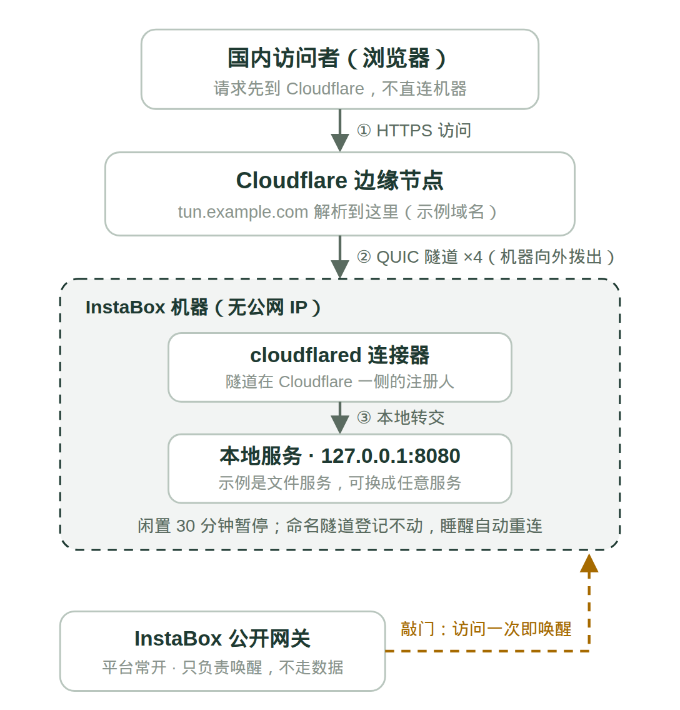

# instabox-tunnel-kit

给 InstaBox 免费云主机的两个小工具：**用 Cloudflare 命名隧道把服务地址永久固定**，外加一个**可选的活动租约保活脚本**。全部来自真实自用实测（55 KB/s → 2.7 MB/s 的定位过程见文末背景）。

## 解决什么问题

InstaBox 免费机有两个让人头疼的平台规则：

1. **闲置 30 分钟自动暂停，单次连续运行满 480 分钟强制冷却。**
2. 机器没有公网 IP，对外只能靠平台的「公开端口」网关（实测回国速度只有几十 KB/s），或者 Cloudflare 快速隧道——但**快速隧道的地址会在机器每次暂停后被注销**，进程还在也没用，两天能换 5 个地址。

本工具包的解法：

- **命名隧道**：把隧道登记在你自己的 Cloudflare 账户名下，地址由你自己的域名决定。机器睡醒后连接器自动重连，**地址永远不变**；睡之前先访问一次公开端口地址「敲门」唤醒即可。
- **活动租约保活（可选）**：调用平台官方 activity lease 接口续租，减少日常暂停。注意它躲不过 480 分钟强制冷却，也唤不醒手动暂停——**固定地址之后其实可以不用保活**，留着给有常开需求的人。



*拓扑示意（域名为示例）：访问者 → Cloudflare 边缘 → 隧道 → 机器里的本地服务；公开网关只负责敲门唤醒，不走数据。*

## 组成

| 文件 | 作用 | 运行位置 |
|---|---|---|
| `setup-named-tunnel.sh` | 一键搭建命名隧道：装 cloudflared、证书授权、建隧道、写配置、配 DNS、装 systemd 服务 | InstaBox 机器上 |
| `keepalive.py` | 活动租约保活（单次运行，配合 cron 每 5 分钟一次） | 任意常开设备（如家里的 NAS） |

## 快速开始 A：命名隧道（固定地址）

前置条件：

- 一台 InstaBox 机器（Debian / Ubuntu）；
- 一个**已托管到 Cloudflare** 的域名：能改 NS、后缀在公共后缀名单（PSL）里。免费域名可以（eu.org 免费但人工审核慢；DigitalPlat 即时到手但要实名验证），别人送的二级域名不行（改不了 NS）；
- 一台能打开浏览器登录 Cloudflare 的设备（授权要用一次）。

在机器上运行：

```bash
git clone https://github.com/nilinfeixiang-png/instabox-tunnel-kit.git
cd instabox-tunnel-kit
sudo bash setup-named-tunnel.sh
```

按提示输入隧道名、子域名（如 `tun.example.com`）、本地服务端口（默认 8080），中间按提示在浏览器里完成一次证书授权，其余全自动。完成后打开 `https://你的子域名` 即可访问本地服务。

几个设计决定，踩过坑才写在这里：

- **不走 Zero Trust 控制台**：那条路开通免费版要先录银行卡；脚本走 `cloudflared tunnel login` 的 cert.pem 本地路线，没卡也能办。
- **systemd 托管 + `Restart=always`**：进程挂了自拉起；命名隧道的登记在 Cloudflare 账户里，不随进程生死。
- **原 config.yml 会自动备份**，重复运行脚本可复用已有隧道。

## 快速开始 B：保活（可选）

先在 InstaBox 控制台创建一个 **受限 API Key**（机器读 + 写即可，**不要给删除权**）。然后在常开设备上：

```bash
export INSTABOX_API_KEY=ibk_xxx
export INSTABOX_MACHINE_ID=m_xxx   # 可选，不填自动取账号下第一台机器
python3 keepalive.py
```

配合 cron 每 5 分钟一次：

```cron
*/5 * * * * INSTABOX_API_KEY=ibk_xxx /usr/bin/python3 /path/to/keepalive.py >> /var/log/instabox-keepalive.log 2>&1
```

环境变量一览：

| 变量 | 默认 | 说明 |
|---|---|---|
| `INSTABOX_API_KEY` | （必填） | 控制台创建的 API Key，只放在控制端本机 |
| `INSTABOX_MACHINE_ID` | 自动 | 目标机器 ID |
| `INSTABOX_LEASE_TTL` | 900 | 租约秒数，平台允许 30–3600 |
| `INSTABOX_LEASE_ID` | 自动派生 | 租约 ID，同一控制端保持稳定即可 |
| `INSTABOX_API_BASE` | https://api.instabox.sh | 接口基址 |

脚本行为：先读机器状态，仅当 `running` / `suspended` 时续租并校验返回；401/403 退出码 1（Key 或权限问题），409/429 视为下一轮再试。纯 Python 标准库，无第三方依赖。

## 安全说明

- `cert.pem` 和隧道凭据 `*.json` 是**等同于钥匙的敏感文件**，已在 `.gitignore` 里排除，切勿提交或外传；
- API Key 只保存在控制端本机（建议文件权限 600 或环境变量注入），不要写进仓库；
- 隧道地址谁拿到都能访问你发布的服务，敏感服务请自己再加一层口令；
- 本地服务只监听本机、经隧道发布，不要再把端口直接暴露到公网。

## 实测背景

这套东西是在一台 InstaBox 免费机（4 vCPU / 8 GiB / Debian 13 / 美国西部出口）上实测打磨出来的：官方公开端口回国下载只有约 55 KB/s；同场对比下 Cloudflare 隧道达到约 2.7 MB/s（同一个 50 MB 文件、同一台 NAS、同一时段，约 49 倍）；命名隧道落地后，机器经历多次暂停与 480 分钟冷却，地址再未变更。完整的测速定位过程与原理分析，见微信公众号「慢一码日记」同题实测文章。

## 限制与免责

- InstaBox 是免费 beta，规则（暂停、冷却、流量 100 GiB/月等）可能随时变化，本工具按 2026-11 的实测口径编写；
- 本项目与 InstaBox、Cloudflare 无任何隶属关系，仅为个人实测工具整理；
- 关键业务不要跑在免费机上。

## License

MIT
